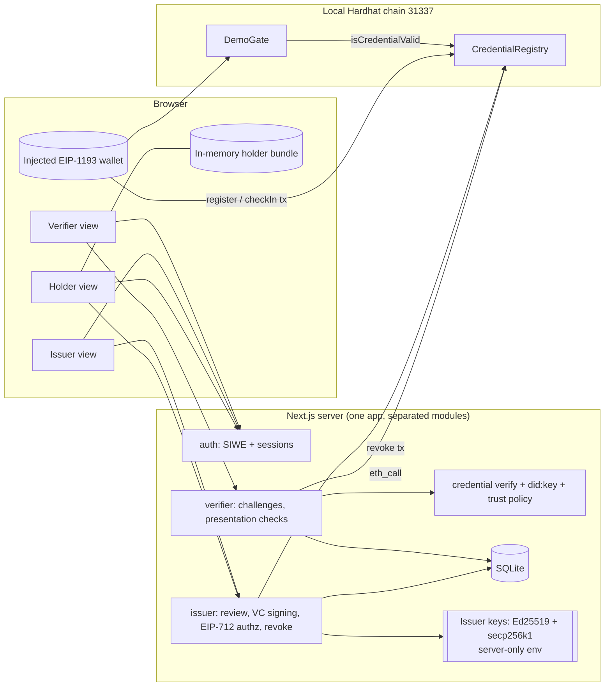

# Architecture

## Purpose and trust assumptions

The prototype demonstrates the *technical* trust chain of a credential, not real identity proofing.

| Question | Who answers it | How |
| --- | --- | --- |
| Is this identifier well-formed? | Verifier | Strict `did:pkh:eip155` / Ed25519 `did:key` parsing |
| Does the presenter control the wallet? | Verifier | SIWE for app sessions; a per-challenge EIP-712 proof for presentations |
| Did a trusted issuer sign this credential? | Verifier | Issuer DID must be in the trust policy; the key comes from the policy, cross-checked with did:key resolution |
| Is it still registered, unrevoked, in-window, issuer active? | Registry (on-chain), read by verifier and DemoGate | `CredentialRegistry` state |
| Is the person who they claim to be in the real world? | **Nobody in this prototype.** | The issuer is simulated, and its “review” is an operator clicking approve on synthetic data |

Assumptions: the issuer's two keys stay secret on its server; the registry admin (deployer, dev account #0) is honest; the local chain is the source of truth for status; holders protect their bundle (token and salt).

## Components



The verifier module imports only the trust policy, the deployment record and the RPC provider. It never imports issuer code or `issuerSecrets()`. A test checks this both statically and by verifying with the issuer keys removed from the environment.

## Issuance, presentation and revocation

```mermaid
sequenceDiagram
  autonumber
  actor Hd as Holder (wallet)
  participant App as App server
  participant Iss as Issuer module
  participant Reg as CredentialRegistry
  participant Gate as DemoGate
  actor Op as Issuer operator

  Hd->>App: SIWE sign-in (role=holder)
  App-->>Hd: session cookie (HttpOnly, SameSite=Strict)
  Hd->>Iss: synthetic application (holder = session address)
  Op->>App: SIWE sign-in (role=issuer, allowlisted)
  Op->>Iss: approve
  Iss->>Iss: derive ageOver18/ageOver21/country → SD-JWT disclosures + 8 digests (decoys)
  Iss->>Iss: build minimal VC with _sd → sign vc+sd-jwt (Ed25519 did:key)
  Iss->>Iss: salt ← CSPRNG(32), commitment = H(domain, salt, H(token))
  Iss->>Reg: (read issuer epoch)
  Iss->>Iss: EIP-712 RegistrationAuthorization signed by EVM attestation key
  Iss->>Iss: erase synthetic data, stage bundle for one-time pickup
  Hd->>Iss: pick up bundle (deleted on the server in the same statement)
  Hd->>Reg: register(authorization, sig) from holder wallet
  Reg-->>Hd: CredentialRegistered(commitment, holder, issuer, schema, window)

  Hd->>App: POST /api/verifier/challenges
  App-->>Hd: {challengeId, nonce, audience, action, chain, registry, expiresAt, requestedClaims}
  Hd->>Hd: pick requested disclosures; consent → EIP-712 PresentationProof (names + sdHash)
  Hd->>App: issuer-signed JWT + disclosures + salt + proof
  App->>App: consume challenge atomically, verify proof, JOSE, trust, semantics, disclosures vs policy, binding, commitment
  App->>Reg: getRecord / credentialStatus / isCredentialValid
  App-->>Hd: per-check result, minimal disclosed claims
  Hd->>Gate: checkIn(commitment)
  Gate->>Reg: isCredentialValid(commitment, msg.sender, schema)

  Op->>Iss: revoke(commitment)
  Iss->>Reg: revoke(commitment) from attestation key
  Hd->>App: fresh presentation → registry check fails (REVOKED)
  Hd->>Gate: checkIn → reverts AccessDenied(Revoked)
```

## Off-chain vs on-chain verification

| | Off-chain (verifier service) | On-chain (registry / gate) |
| --- | --- | --- |
| Sees the credential | Yes: exact token bytes and salt, transiently | **No**, only the commitment |
| Checks issuer signature on the VC | Yes (Ed25519, trusted key) | No |
| Checks VC semantics (profile, claims, dates, subject) | Yes | No |
| Checks issuer authorization of the commitment | Indirectly (record issuer must equal the trusted attestation signer) | Yes (EIP-712 + ECDSA at registration) |
| Checks wallet control | EIP-712 presentation proof | `msg.sender` |
| Checks revocation / expiry / issuer active | Reads registry live | Yes, natively |
| Establishes real-world identity | **No** | **No** |

A valid-looking registry entry never makes an invalid token acceptable: the verifier recomputes the commitment from the submitted bytes and salt. It then requires the token to pass every off-chain check *and* the record to match holder, issuer, schema and validity window.

## Contract responsibilities

**CredentialRegistry** (no proxy, no tokens)
- `DEFAULT_ADMIN_ROLE` (OpenZeppelin AccessControl): `addIssuer`, `removeIssuer`, `adminRevoke` (explicit override, evented with `adminOverride=true`).
- `register(auth, sig)`: requires `auth.deploymentId` to equal this deployment's random id, `msg.sender == auth.holder`, deadline not passed, `validFrom < expiresAt`, not already expired, issuer active, `auth.issuerEpoch ==` current epoch, commitment never registered before, and an OpenZeppelin `ECDSA` signature (rejects high-s and bad length/v) from `auth.issuer` over the EIP-712 digest.
- `revoke(commitment)`: only the record's issuer (even if since removed).
- `cancelAuthorization(commitment)`: an active issuer withdraws an unregistered authorization it signed (scoped to `msg.sender`); used by account recovery.
- Views: `credentialStatus` (None / Active / Revoked / IssuerInactive / NotYetValid / Expired), `isCredentialValid(commitment, holder, schemaId)`, `getRecord`, `issuerState`, `hashAuthorization`, `domainSeparator`.
- Issuer removal increments the issuer's epoch. Older records and unsubmitted authorizations become permanently invalid, re-adding the issuer restores neither, and individual revocations are never cleared.

**DemoGate**: `checkIn(commitment)` succeeds only if `registry.isCredentialValid(commitment, msg.sender, requiredSchema)`. Otherwise it reverts `AccessDenied(status, wrongHolderOrSchema)`.

## API responsibilities

| Route | Auth | Purpose |
| --- | --- | --- |
| `GET /api/config` | public | Deployment addresses, chain, trusted issuer *public* identifiers |
| `POST /api/auth/challenge` | public, rate-limited | Server-built SIWE message with a single-use nonce |
| `POST /api/auth/verify` | public, rate-limited | Verify SIWE, create session (role fixed at sign-in) |
| `GET /api/auth/session`, `POST /api/auth/logout` | cookie | Session state |
| `GET/POST /api/holder/requests` | holder | List own requests / submit synthetic application |
| `POST /api/holder/requests/:id/bundle` | holder (owner) | One-time bundle pickup |
| `GET /api/issuer/requests` | issuer | Pending synthetic applications |
| `POST /api/issuer/requests/:id/decision` | issuer | Approve (issue) or reject |
| `GET /api/issuer/credentials`, `POST /api/issuer/credentials/revoke` | issuer | Issuance log with live status; on-chain revocation |
| `GET /api/issuer/audit` | issuer | Newest 50 audit entries and the verification of the whole hash chain |
| `GET /api/verifier/history` | public | Recent verifications: reference, action, time, outcome code |
| `POST /api/verifier/challenges` | public, rate-limited | Create single-use challenge |
| `POST /api/verifier/presentations` | public, rate-limited | Verify a presentation (200 verified / 422 not) |

The machine-readable description is [openapi.json](openapi.json), generated from the request and response zod schemas and checked against real responses by the test suite.

Every non-GET request must carry `Origin` equal to `APP_ORIGIN` and a JSON body of at most 32 KiB. Errors are `{ "error": { "code", "message" } }` with stable codes. Validation errors name fields, never submitted values, and stack traces are never returned.

## Data placement

| Data item | Where it lives | Who can read it | Retention |
| --- | --- | --- | --- |
| Synthetic application (name, DOB, document no., country) | SQLite `issuer_requests.synthetic_json` | Issuer operators | Erased (set NULL) when the request is approved or rejected |
| Request status, holder address/DID, timestamps, reject reason, recovery link (lost wallet address) | SQLite `issuer_requests` | Issuer; the holder sees their own | Until `npm run reset` |
| Issuance log: commitment, credential id, holder DID, validity, authorizing signer, superseded-by-recovery | SQLite `issuer_credentials` | Issuer | Until reset |
| Issuer audit log: sequence, time, operator address, action, subject (commitment or request id), details (credential id, holder DID, signer, tx hash, reject reason), previous hash, hash | SQLite `issuer_audit` | Issuer | Append-only; until reset |
| Holder bundle (issuer-signed JWT, SD-JWT disclosures of ageOver18/ageOver21/countryOfResidence, salt, authorization) awaiting pickup | SQLite `issuer_bundle_pickup` | That holder only | Deleted at pickup, or after 24 h |
| Holder bundle after pickup | Browser tab memory | The holder | Until reload or wallet switch |
| Encrypted backup file | Wherever the holder saves it | Anyone with the password | Holder-controlled |
| Device vault (same encrypted envelope) | Browser IndexedDB, keyed by wallet address | Anyone with the passphrase and access to that browser profile | Until the holder removes it or clears site data |
| Credential token and salt during verification | Verifier process memory | Verifier | Not persisted |
| Challenge (nonce, action, audience, chain, registry, expiry, outcome code) | SQLite `verifier_challenges` | Verifier | 1 h after expiry |
| SIWE nonces / sessions (SHA-256 of cookie, address, role) | SQLite `auth_*` | Server | Nonces 5 min, sessions 1 h |
| Issuer Ed25519 + secp256k1 private keys | `.env.local` (0600, git-ignored), server env only | Server process | Until rotated (`npm run setup -- --force`) |
| Trust policy (issuer DID, kid, public JWK, attestation address) | `config/trusted-issuers.local.json` | Server; public identifiers via `/api/config` | Until regenerated |
| Commitment, holder address, issuer address, schema id, validFrom, expiresAt, issuer epoch, registeredAt, revoked flag | `CredentialRegistry` storage + events | **Everyone with chain access** | **Permanent** (chain history) |
| Registration, check-in and revocation transactions (sender, calldata, gas, time) | Chain | **Everyone** | **Permanent** |
| Gate check-in counter per address | `DemoGate` storage | Everyone | Permanent |

### Public on-chain fields

- **commitment**: random-looking 32 bytes. It cannot be linked to a token without the salt.
- **holder**: the holder's wallet address. This is *linkable* across everything that wallet does.
- **issuer**: the attestation signer address, which reveals *which issuer* vouched for this holder.
- **schemaId**: hash of the schema URI. It reveals the *kind* of credential (here “identity verified”).
- **validFrom / expiresAt / registeredAt**: timestamps that can correlate with off-chain events.
- **issuerEpoch, revoked**: status. Revocation of a specific holder's credential is public.
